

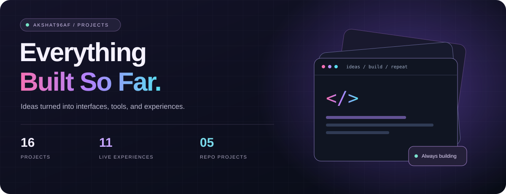

A collection of things I've built: desktop experiences, streaming platforms, everyday tools, and frontend experiments.

## Project index

Pick a project to explore its preview, description, and links.

| No. | Project | What it is | Explore |
| :-- | :-- | :-- | :-- |
| 01 | [MacOS](#macos) | Desktop Simulator | Live |
| 02 | [Latent Hub](#latent-hub) | Streaming Platform | Live |
| 03 | [SoulOS](#soulos) | Web OS Concept | Live |
| 04 | [Flare](#flare) | Windows Command Center | Repository |
| 05 | [Lossify](#lossify) | Hi-Res Music Streaming | Live |
| 06 | [Presence](#presence) | Attendance Tracker | Live |
| 07 | [Omnibypass](#omnibypass) | Browser Utility | Live |
| 08 | [TubeDeck](#tubedeck) | YouTube Companion Extension | Repository |
| 09 | [Frontend Skills Vault](#frontend-skills-vault) | Learning Archive | Repository |
| 10 | [Solitaired](#solitaired) | Klondike Solitaire | Live |
| 11 | [SyncLab](#synclab) | Collaborative Music Platform | Live |
| 12 | [PS5 UI](#ps5-ui) | UI Recreation | Live |
| 13 | [Portfolio](#portfolio) | Personal Site | Live |
| 14 | [AI Watermark Master Skill](#ai-watermark-master-skill) | Skill Archive | Repository |
| 15 | [Xcloud Keyboard/Mouse](#xcloud-keyboard-mouse) | Chrome Extension | Repository |
| 16 | [ProTrack](#protrack) | Tracking Dashboard | Live |

<h2 align="center"></h2>

<table>
<tr>
<td width="54%" valign="top">

<h3></h3>

<b>DESKTOP SIMULATOR</b>

Mac vibes, zero install. Boot it up, get through setup, drag windows around, and forget you’re still in a browser.

`React` `UI Recreation` `Web App`

</td>
<td width="46%" valign="middle" align="center">
<a href="https://akshat96af.github.io/MacOS/">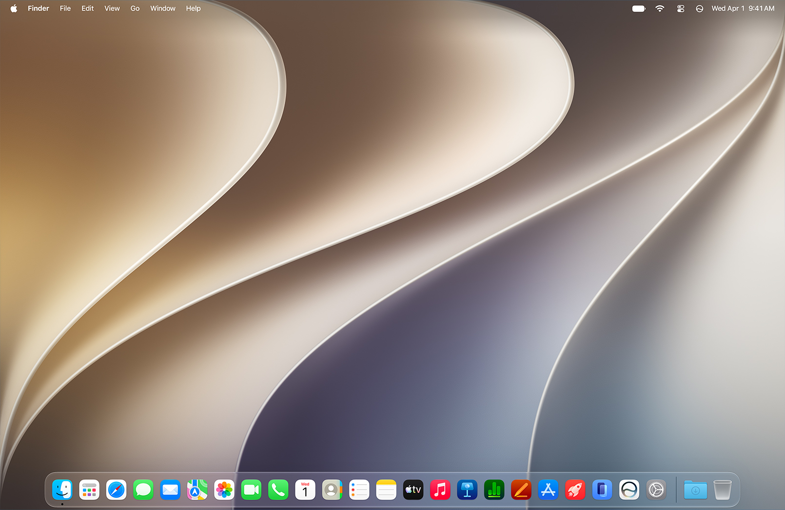</a>
</td>
</tr>
</table>

<table>
<tr>
<td width="54%" valign="top">

<h3></h3>

<b>STREAMING PLATFORM</b>

Built because watching Latent shouldn't feel harder than watching Netflix. Faster loads, cleaner playback, and less clutter between you and the episode.

`Streaming` `Media Player` `Web App`

</td>
<td width="46%" valign="middle" align="center">
<a href="https://watch.latent.indevs.in">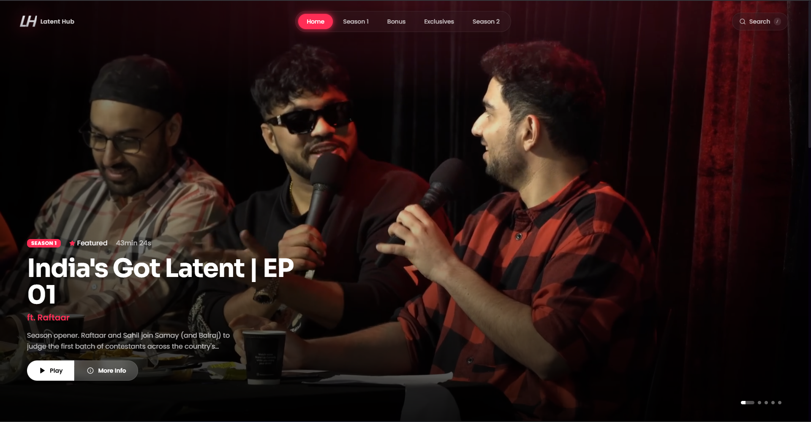</a>
</td>
</tr>
</table>

<table>
<tr>
<td width="54%" valign="top">

<h3></h3>

<b>WEB OS CONCEPT</b>

Linux freedom, macOS polish, and Windows familiarity—all in one ridiculously smooth web OS preview.

`Web OS` `UI/UX` `Motion Design`

</td>
<td width="46%" valign="middle" align="center">
<a href="https://akshat96af.github.io/SoulOS/">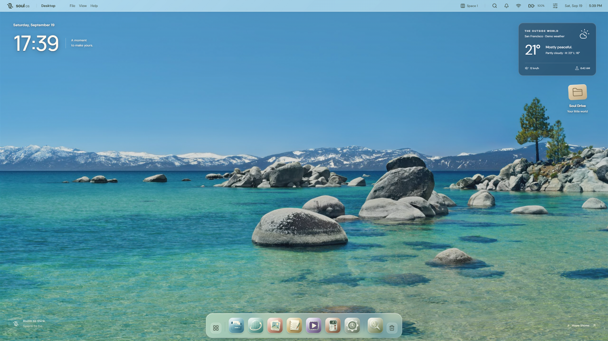</a>
</td>
</tr>
</table>

<table>
<tr>
<td width="54%" valign="top">

<h3></h3>

<b>WINDOWS COMMAND CENTER</b>

A keyboard and voice command center for Windows. Find files across drives, act on the selected result, and bring local search, file tools, and optional AI into a glass-inspired launcher. Currently a working preview.

`Windows` `Productivity` `Voice Commands`

</td>
<td width="46%" valign="middle" align="center">
<a href="https://github.com/Akshat96af/Flare">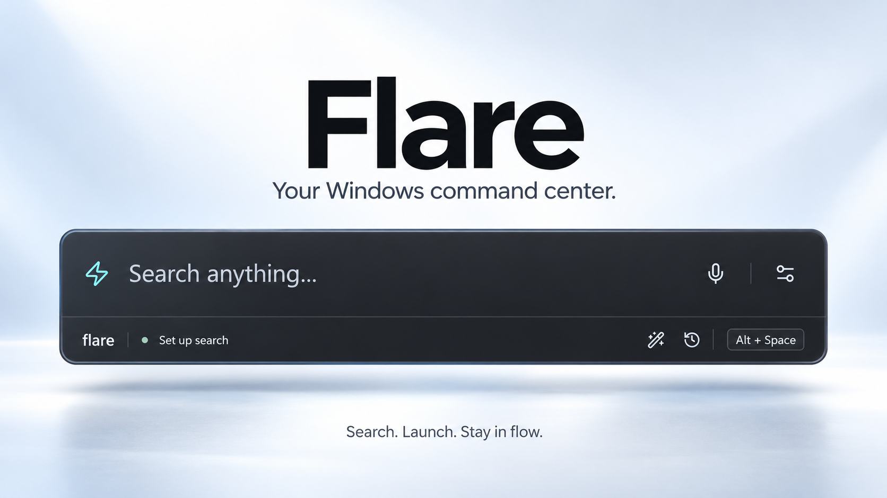</a>
</td>
</tr>
</table>

<table>
<tr>
<td width="54%" valign="top">

<h3></h3>

<b>HI-RES MUSIC STREAMING</b>

Music streaming for people who actually care about audio quality. Hi-res tracks, smooth UI, and zero unnecessary noise getting between you and the music.

`Audio Streaming` `Hi-Res Media` `PWA`

</td>
<td width="46%" valign="middle" align="center">
<a href="https://akshat96af.github.io/lossify/">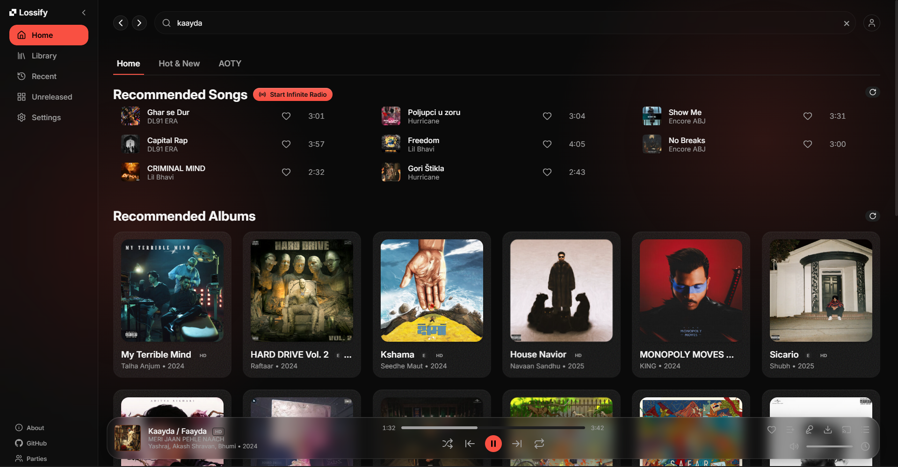</a>
</td>
</tr>
</table>

<table>
<tr>
<td width="54%" valign="top">

<h3></h3>

<b>ATTENDANCE TRACKER</b>

Because nobody wants to calculate attendance percentages manually at 2AM before internals. Presence keeps track of everything so you don't have to.

`Productivity` `Tracker` `Web App`

</td>
<td width="46%" valign="middle" align="center">
<a href="https://akshat96af.github.io/Presence/">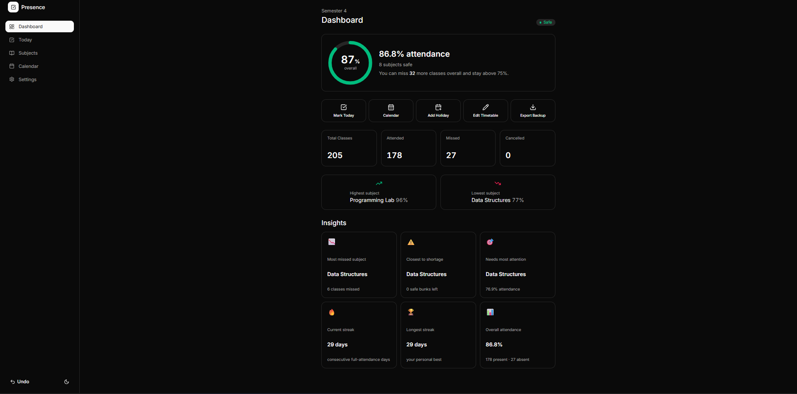</a>
</td>
</tr>
</table>

<table>
<tr>
<td width="54%" valign="top">

<h3></h3>

<b>BROWSER UTILITY</b>

15-second timers are annoying. Omnibypass skips the fake waiting game and gets you to the actual link instantly.

`Browser Utility` `Automation` `Productivity`

</td>
<td width="46%" valign="middle" align="center">
<a href="https://akshat96af.github.io/omnibypass">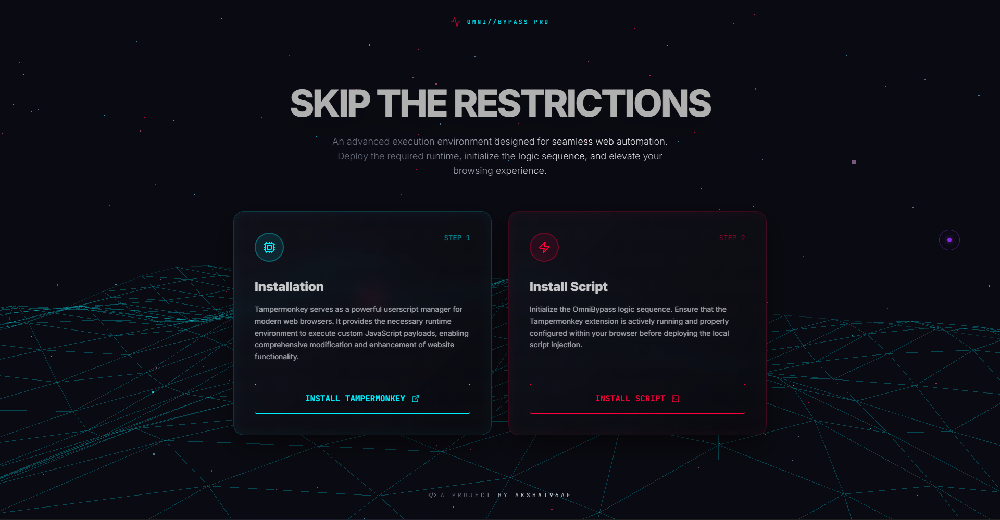</a>
</td>
</tr>
</table>

<table>
<tr>
<td valign="top">

<h3></h3>

<b>YOUTUBE COMPANION EXTENSION</b>

Go deeper into the video you’re watching. TubeDeck brings transcripts, video Q&A, notes, comments, screenshots, references, and supported downloads into a companion panel for YouTube. AI features use your own Gemini API key.

`Chrome Extension` `YouTube` `AI`

</td>
</tr>
</table>

<table>
<tr>
<td width="54%" valign="top">

<h3></h3>

<b>LEARNING ARCHIVE</b>

A growing collection of UI/UX components, frontend layouts, and web experiments made for frontend developers who want to build faster, learn by doing, and get better results.

`HTML` `CSS` `JavaScript` `Reference`

</td>
<td width="46%" valign="middle" align="center">
<a href="https://github.com/Akshat96af/frontendskills">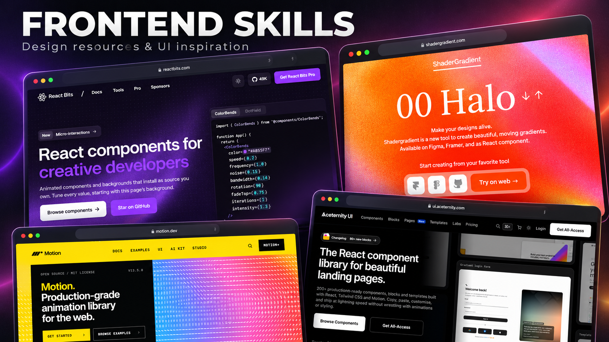</a>
</td>
</tr>
</table>

<table>
<tr>
<td width="54%" valign="top">

<h3></h3>

<b>KLONDIKE SOLITAIRE</b>

A royal take on classic Klondike. Play Draw 1 or Draw 3, try a Daily Deal, and keep track of your high scores on a green-and-gold card table.

`Card Game` `Klondike` `Web App`

</td>
<td width="46%" valign="middle" align="center">
<a href="https://akshat96af.github.io/Solitaired/">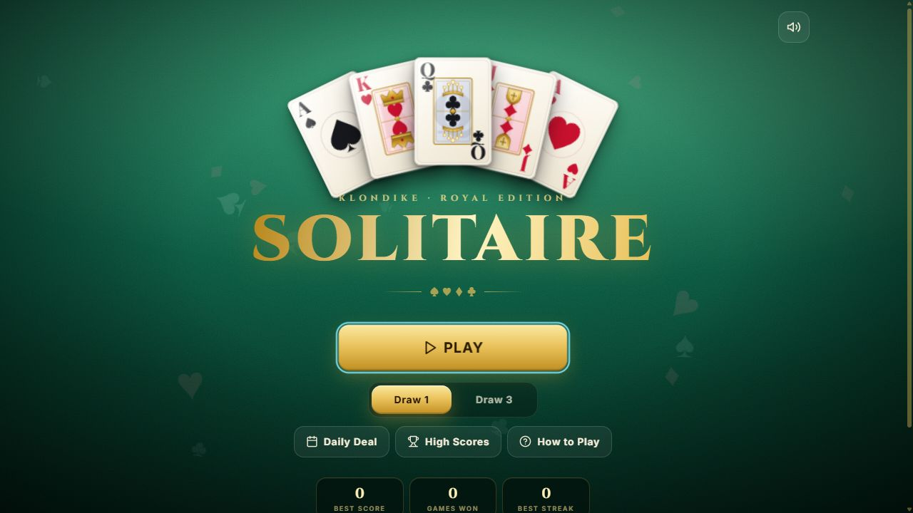</a>
</td>
</tr>
</table>

<table>
<tr>
<td width="54%" valign="top">

<h3></h3>

<b>COLLABORATIVE MUSIC PLATFORM</b> · OLD V1

No more yelling “3, 2, 1, play” in the group chat. SyncLab keeps everyone's music in sync while friends queue songs, vote, and fight over who gets DJ mode.

`Music Streaming` `Real-Time Collaboration` `Web App`

</td>
<td width="46%" valign="middle" align="center">
<a href="https://akshat96af.github.io/SyncLab">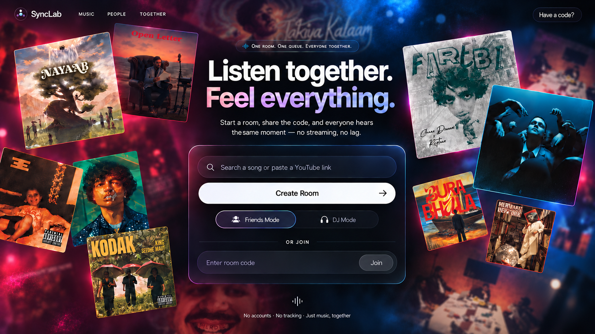</a>
</td>
</tr>
</table>

<table>
<tr>
<td width="54%" valign="top">

<h3></h3>

<b>UI RECREATION</b>

I thought the PS5 dashboard looked cool, so I rebuilt it in the browser using plain HTML, CSS, and JavaScript just to see if I could.

`UI Recreation` `CSS Animation` `Design Engineering`

</td>
<td width="46%" valign="middle" align="center">
<a href="https://akshat96af.github.io/ps5ui/">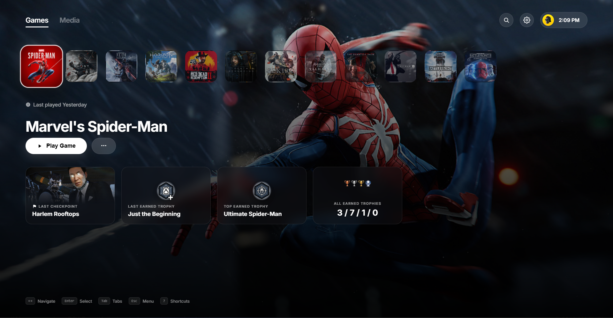</a>
</td>
</tr>
</table>

<table>
<tr>
<td width="54%" valign="top">

<h3></h3>

<b>PERSONAL SITE</b>

The place where everything lives. Projects, experiments, and whatever I'm currently obsessed with building.

`Personal Site` `Portfolio` `Design`

</td>
<td width="46%" valign="middle" align="center">
<a href="https://akshat96.qzz.io">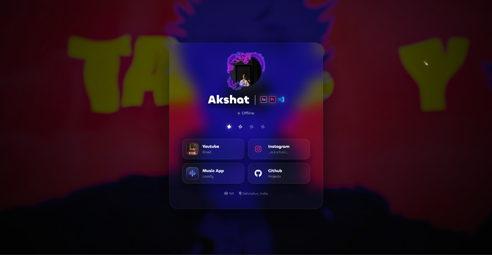</a>
</td>
</tr>
</table>

<table>
<tr>
<td valign="top">

<h3></h3>

<b>SKILL ARCHIVE</b>

A structured collection of rules, prompts, and patterns designed to clean up AI outputs and remove unwanted structural watermarks.

`Markdown` `AI` `Prompt Engineering`

</td>
</tr>
</table>

<table>
<tr>
<td valign="top">

<h3></h3>

<b>CHROME EXTENSION</b>

Xbox Cloud Gaming flat out refuses to run on PC without a controller plugged in. This extension hooks into the browser's HTML5 Gamepad API and translates your keyboard and mouse input into virtual controller signals on the fly, so you can finally play the way you want.

`HTML` `JavaScript` `Chrome Extension`

</td>
</tr>
</table>

<table>
<tr>
<td valign="top">

<h3></h3>

<b>TRACKING DASHBOARD</b>

A simple way to track rural athletes' progress, wins, and milestones without the messy paperwork. It keeps a digital record of everything in one place, so nothing gets lost.

`Tracker` `Dashboard` `Web App`

</td>
</tr>
</table>

<h2 align="center"></h2>

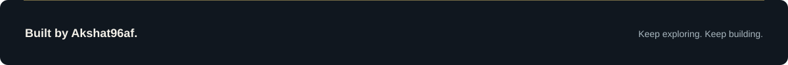

